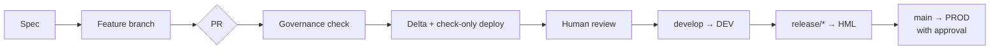

# Salesforce Org Governance Kit

**A Salesforce org managed as code: least-privilege access, automation with bypass and error handling,
and a delta-based release pipeline that runs the same way on GitHub Actions and Azure DevOps.**


> **Resumo em português:** kit de governança para uma org Salesforce. Acesso por permission set groups
> (sem perfis), Flows com bypass e tratamento de erro, regras de validação com bypass por custom
> permission, checagem automática de governança e esteira de deploy delta (sfdx-git-delta) com
> promoção develop → release → main, em GitHub Actions e Azure DevOps. Baseado no padrão que uso em
> projetos reais, sem nenhum código ou dado de cliente.

---

## What is in here

| Area | What it shows | Where |
| --- | --- | --- |
| **Access model** | Persona-based permission set groups, no profiles, least-privilege integration user, bypass granted in one place only | [`force-app-config/`](force-app-config/main/default) · [docs/access-model.md](docs/access-model.md) |
| **Data model and rules** | Case escalation fields, validation rules that respect a bypass custom permission, an error log object | [`force-app-base/`](force-app-base/main/default) |
| **Automation** | Before-save and after-save flows with tight entry criteria, a fault path on every DML, a reusable logging subflow | [`force-app-service/`](force-app-service/main/default/flows) · [docs/automation-standards.md](docs/automation-standards.md) |
| **Governance check** | A dependency-free script that fails the PR on rule violations before any org is touched | [`scripts/governance-check.js`](scripts/governance-check.js) |
| **Release pipeline** | Delta deploys, check-only validation on PRs, branch-to-environment promotion, approvals for production | [`.github/workflows/`](.github/workflows) · [`azure-pipelines/`](azure-pipelines) · [docs/release-process.md](docs/release-process.md) |
| **Operations** | Change runbook, root cause analysis template and a worked example | [docs/change-runbook.md](docs/change-runbook.md) · [docs/rca-template.md](docs/rca-template.md) · [example](docs/rca-example-chat-attachments.md) |
| **AI-assisted delivery** | Spec-driven work with an AI agent under human review gates | [docs/ai-assisted-delivery.md](docs/ai-assisted-delivery.md) · [`CLAUDE.md`](CLAUDE.md) · [`specs/`](specs) |

## How a change reaches production



1. **Governance check** blocks the PR if, for example, a validation rule has no bypass, a flow has a DML
   without a fault path, or a permission set grants Modify All Data.
2. **sfdx-git-delta** builds a package with only what changed, plus a destructive manifest for deletions.
3. **Check-only deploy** runs against the environment the PR promotes to.
4. **Merge deploys** the same delta. Production requires an approval. Every delta is kept as an artifact.

## Repository layout

```
force-app-base/      data model: objects, fields, validation rules, custom permissions
force-app-config/    access: permission sets, permission set groups
force-app-service/   behaviour: flows (and Apex, if any)
force-app-ui/        presentation: layouts, Lightning pages, LWC
scripts/
  governance-check.js   rule checks, no dependencies
  organize.sh           moves retrieved metadata into the right layer
  simulate-release.sh   local dry run of a release (commits, delta, check-only deploy)
  ci/                   shared by both pipelines: install, auth, delta, deploy, branch → env
.github/workflows/   GitHub Actions: PR validation, deploy
azure-pipelines/     Azure DevOps: the same two pipelines, same scripts
specs/               spec-driven work items (spec, plan, tasks)
docs/                access model, automation standards, release process, runbook, RCA
templates/           CONTEXT handoff template for long workstreams
```

Splitting metadata into four layers keeps reviews focused (an access change only touches
`force-app-config`) and makes ownership obvious in `CODEOWNERS`.

## Try it

```bash
# Rules only, no org needed
node scripts/governance-check.js

# Deploy to a Developer Edition or scratch org
sf org login web --alias my-dev
sf project deploy start --target-org my-dev \
  --source-dir force-app-base --source-dir force-app-config --source-dir force-app-service
sf org assign permset --name Service_Agent_Base --target-org my-dev

# Simulate a release between two refs, with a check-only deploy
scripts/simulate-release.sh origin/main HEAD my-dev
```

To run the pipelines against real orgs, add a secret `SFDX_AUTH_URL` to the GitHub environments
`dev`, `hml`, `prod` (and `*-validation`), or to the Azure DevOps variable groups `sf-dev`, `sf-hml`,
`sf-prod`. On GitHub Actions, an environment without the secret runs the governance check and skips
the org steps with a notice, which is how this public repo runs. The Azure DevOps YAML is a reference
version of the same pipeline: there the variable groups must exist before the first run.

## About

Built by **Gabriel Cunha**, Salesforce Tech Lead and administrator, 6x Salesforce certified
(Administrator, Advanced Administrator, Platform App Builder, Platform Data Architect, Data 360 Consultant,
Agentforce Specialist).
[LinkedIn](https://www.linkedin.com/in/gfncunha)
