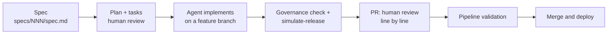

# AI-assisted delivery

AI agents (Claude Code and similar) speed up the work before the pull request. They do not change who
is accountable for what reaches the org: a person reviews every line and the pipeline checks every change.

## Rules

1. **Spec first.** The agent works from `spec.md`, `plan.md` and `tasks.md` (spec-driven development, in
   the style of GitHub Spec Kit). No spec, no code: the agent writes the spec and stops for review.
2. **Repo rules are written down.** `CLAUDE.md` gives the agent the structure, naming, governance rules and
   what it must never do.
3. **Machines check what machines can.** The governance check and the check-only deploy catch rule
   violations before a reviewer spends time on the PR.
4. **People check judgement.** Reviewers focus on impact: access granted, interaction with other
   automation, data, integrations. The PR template asks for this explicitly.
5. **No agent touches an org.** Deployments happen only through the pipeline, after merge.
6. **Context survives the session.** Long workstreams end with a `CONTEXT_<topic>.md` (from
   `templates/CONTEXT_TEMPLATE.md`) so the next session, human or agent, starts from the decisions already made.
