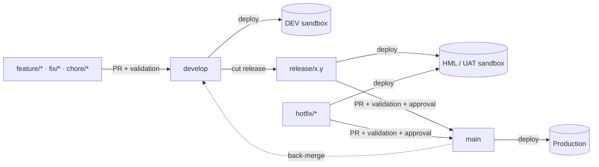

# Release process

Every change reaches production through git and the pipeline. Nobody deploys from a laptop or a
change set.

## Branches and environments



| Branch | Deploys to | Who merges | Gate |
| --- | --- | --- | --- |
| `develop` | DEV | Any reviewer | PR validation green |
| `release/*` | HML | Platform owner | PR validation green, business sign-off in HML |
| `hotfix/*` | HML | Platform owner | Reproduced and fixed in HML |
| `main` | Production | Platform owner | PR validation green + environment approval |

## What the pipeline does

1. **Governance check** (`scripts/governance-check.js`): access and automation rules, no org needed.
2. **Delta** (`scripts/ci/build-delta.sh`): sfdx-git-delta builds a package with only what changed,
   plus a destructive manifest for what was removed.
3. **Check-only deploy on the PR** (`scripts/ci/deploy.sh validate`) against the environment the base
   branch promotes to. Local tests run.
4. **Deploy on merge** (`scripts/ci/deploy.sh deploy`). Metadata-only releases skip Apex tests; releases
   with Apex run local tests. Deletions run after the deploy.
5. **Checkpoint** (`scripts/ci/checkpoint.sh`). After a successful deploy the tag `deployed/<env>` moves
   to that commit, and the next deploy diffs from it, not from the previous commit. A failed deploy is
   therefore retried by the next merge instead of silently missing from the org.
6. **The delta is kept** as a build artifact, so every deployment can be audited.

### Deletions

- Deleting a whole object is refused unless the run sets `ALLOW_OBJECT_DELETION=true`. An object deletion
  takes its data with it, so it is a reviewed decision, never a side effect of removing a folder.
- Deletions run with `--ignore-warnings`: an environment that never received a component reports its
  deletion as a warning, and that alone would otherwise fail the deploy.

The same scripts run on GitHub Actions (`.github/workflows/`) and Azure DevOps (`azure-pipelines/`).

## Before opening a release PR

```bash
scripts/simulate-release.sh origin/main release/2026.12 my-hml-alias
```

Shows the commits, the delta and runs a check-only deploy, without deploying anything.

## Rollback

- **Metadata change:** revert the PR on the branch; the pipeline deploys the revert.
- **Flow:** activate the previous version in the org, then revert in git so the repo matches.
- **Access:** remove the permission set group assignment first, fix the metadata after.
- **Deletion:** cannot be undone by revert alone for fields with data; deletions of fields need a data
  export before the release (see `change-runbook.md`).
